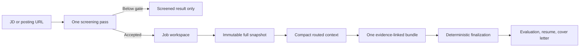

# JobSensei Product Flows

This guide explains what happens inside JobSensei, why each workflow is bounded, and where users can safely customize behavior. The main [README](README.md) covers installation and the product overview; this document covers operation.

## Core Model

JobSensei separates four concerns:

| Layer | Purpose | Authority |
| --- | --- | --- |
| Candidate profile | Identity, chronology, preferences, source locations | Local `data/profile/candidate.json` |
| Career context | Detailed facts about work, projects, education, and skills | User-selected files under `data/context/` |
| Agy skills | Instructions for screening, drafting, and interview preparation | Public `.agents/skills/` files |
| Deterministic app code | File safety, protected resume composition, validation, viewing, and PDF export | Electron main process |

The base resume protects presentation and fixed career fields. It is not trusted as proof of every bullet. Selected structured context is the primary factual source, while broad context, LinkedIn, and secondary resumes have narrower supporting roles.

## First Launch

1. JobSensei creates the local `data/` workspace.
2. First-run steps, all in the app: your name and file prefix; your base resume (the app shows what it read); Agy sign-in; then recommended extras (career files, career story, interview logistics, names to keep private, writing voice). The Setup page in the sidebar keeps the same list with what each step improves.
3. Adding a job waits until the required steps (name, a readable base resume, Agy installed) are done.
4. Career evidence is added under `data/context/structured/`; source notes may be added under `data/context/broad/`.
5. The app creates an active context manifest from the files selected in the interface.
6. The Agy panel (top bar → Agy) launches Agy from the repository root so it can discover `.agents/skills/`.

Personal information belongs in the ignored `data/` workspace. Public skills must remain candidate-neutral.

## Job Application Flow

**Trigger:** paste a JD or direct posting URL into Agy.

**Orchestrator:** `jobsensei-application-pipeline`

The snapshot command stores a complete private verification archive. It also creates a compact drafting packet containing the same selected claims needed for the job without repeating full profile, route, source, and policy data. Agy reads that packet once and writes one `application_bundle.json`, with evidence IDs beside each generated claim.

The finalizer then:

- restores protected identity, contact details, employers, titles, dates, locations, education, and structure from the base-resume baseline;
- derives the hidden draft and evidence map without another AI pass;
- calculates the authoritative score: Agy rates each of the posting's own requirements against your evidence, and the app sets the weights, checks each rating against the cited evidence and the posting's wording, and derives the must-haves (met / to learn / blocker). A role you match only through transferable experience lands around 3.5; the gate is 3.2;
- removes skills no evidence supports, keeps earlier roles exactly as in your base resume unless a change cites that employer, and measures the **stretch**: how much of the resume was tailored and how far each changed line reaches past its evidence (shown beside the fit score, never part of it);
- writes the reviewable Markdown resume, cover letter, and evaluation;
- stops after one attempt, even when review warnings exist.

This structure keeps Agy fast without making it blind: evidence coverage remains in the immutable snapshot, while only duplicate metadata and repeated instructions are removed from the model-facing packet.

### Application Skills

| Skill | When to use it | Responsibility |
| --- | --- | --- |
| `jobsensei-application-pipeline` | New JD or URL | Sole application orchestrator and normal entry point |
| `jobsensei-job-intake` | Existing approved job or metadata refresh | Normalizes an already accepted workspace |
| `jobsensei-job-match` | Explicit reevaluation | Updates the single evaluation document |
| `jobsensei-resume-tailor` | Explicit resume-only revision | Revises editable resume content from pinned evidence |
| `jobsensei-application-writer` | Explicit letter or short-answer revision | Revises application prose without running the full pipeline |
| `jobsensei-career-evidence` | Evidence maintenance or truth review | Structures, inspects, and audits factual career evidence |

The narrower skills do not run automatically during a new-JD flow. This prevents repeated reading, duplicate artifacts, and conflicting instructions.

## Review And PDF Flow

Generated Markdown is a draft for human review. Users can open and edit Markdown in the document viewer. PDF export begins only when the user clicks the export action.

The exporter uses artifact-specific layouts, checks page count and extraction, and preserves the previous valid PDF if a new export fails. Evidence and internal warnings stay out of employer-facing files.

## Interview Flow

**Trigger:** explicitly ask Agy to prepare an existing job for an interview.

**Orchestrator:** `jobsensei-interview-pipeline`

The interview pipeline resolves one existing job, identifies the requested stage, researches the company or process when appropriate, and creates stage-aware `research.md`, `prep.md`, and `question_bank.md` files. A pasted JD never activates this flow.

| Skill | Responsibility |
| --- | --- |
| `jobsensei-interview-pipeline` | Creates or advances round-specific preparation |
| `jobsensei-interview-coach` | Runs text mocks, improves answers, and creates feedback or debrief analysis |
| `jobsensei-technical-challenge` | Creates labs or scenarios only after an explicit challenge/test request |

Challenge material is kept separate until explicitly requested.

### How interview prep works

The detailed rules live in `.agents/skills/jobsensei-interview-pipeline/SKILL.md`; this is the user-facing summary.

- **Four rounds, prepared one at a time:** recruiter screen, hiring manager, practical evaluation (named for the role: role-play for sales, product case for PM, customer scenario for solutions roles, and so on), and final panel. Rounds never repeat a question, story, or reverse question.
- **Questions you could actually be asked:** every question and exercise is a generic version of the job's own work, answerable by a strong candidate from another company. Product knowledge you'd want goes in a short "Learn before the interview" list instead.
- **Talking points, not scripts:** each card has why they ask, 3–5 short "Say" points that name real things, a "Proof" from your story bank (or your approach for hypotheticals), a likely follow-up on the questions most likely to get one, and a 3–6 word "land on" point to finish on.
- **Your gaps, handled:** each round includes 1–3 questions about requirements you don't fully meet, answered as closest real experience plus a ramp plan.
- **Your logistics, your words:** location, authorization, compensation, and notice come from Settings → Interview Prep and are never guessed.
- **Checked:** `interview:check` flags invented logistics, unknown evidence, reused stories, scripted answers, banned phrases, local paths, and company-specific practice labs.

### Your story bank and interview voice

- `profile/story_bank.md`: 6–8 true stories, built once and edited by you. Every round picks from it.
- `profile/interview_voice.md`: the words you naturally use, how you structure answers, and 3–5 delivery fixes with a then → aim tracker. Prep opens with your fixes; practice mocks score each answer against them.
- Import recorded interviews (Granola, Otter, notes) with the interview-review workflow. It drafts question patterns, voice notes, story proposals, and logistics; you confirm before anything is saved.
- Transcripts are performance records. A work story you told becomes career evidence only after you confirm it into `context/structured/interview-stories.md`; then resumes, letters, and interviews can use it.

## Context Selection

The UI checkboxes determine which career and job files appear in the active manifest. Structured and broad files are separate so users can control precision versus clarification.

Best practices:

- Keep structured evidence atomic, dated, scoped, and tied to a source locator.
- Record contribution honestly: distinguish built, contributed, tested, supported, and led.
- Put disputed or exaggerated claims in the denylist instead of relying on memory.
- Select only job files intentionally; unrelated jobs can contaminate wording.
- Use broad source files to clarify structured evidence, not as duplicate corroboration.
- Refresh the context manifest after changing source selection before starting a new Agy task.

## Customizing Skills

Skills are Markdown instructions under `.agents/skills/<skill-name>/SKILL.md`. Users may edit them, but should keep candidate facts out of public skill files.

Safe customization sequence:

1. Put personal identity, chronology, output preferences, and source paths in `data/profile/candidate.json`.
2. Put factual work details in structured context and writing preferences in the configured voice profile.
3. Change a skill only when the workflow itself should behave differently for every candidate.
4. Prefer replacing or shortening a conflicting rule over adding another rule at the end.
5. Keep one skill as the orchestrator for each flow; do not make it reread downstream skills during normal execution.
6. Keep fixed validation and file composition in TypeScript rather than asking Agy to reason about implementation code.
7. Test changes with fictional fixtures before using private applications.

Avoid embedding names, employers, exact personal claims, credentials, or machine-specific paths in `.agents/`, `AGENTS.md`, tests, or examples. Those files are intended to be safe to publish.

## Performance Principles

- Start a fresh Agy task for each JD.
- Use low reasoning for routine application drafting; increase it only for an unusually complex role.
- Keep the application sequence to one fetch, one intake batch, one snapshot, one context read, one bundle write, and one finalization.
- Do not inspect validators or source code during a routine application.
- Treat warnings as review information, not as an invitation to repair automatically.
- Never regenerate all artifacts merely to fix hidden timestamps or validation metadata.

## Privacy Boundary

The repository ignores `data/`, local plans, environment files, build output, and caches. Before publishing a fork, inspect the complete tracked-file list and run credential and identity scans. The fictional workspace under `examples/` is the only candidate data intended for source control.

See [Privacy](docs/privacy.md), [Workspace Format](docs/workspace-format.md), and [Security](SECURITY.md) for the supporting contracts.

## Using the app

- **Add jobs:** paste posting links into the job queue on the Jobs page. Agy runs one at a time; with "Run automatically" on, the next link starts when the last application finishes. A link that stalls is marked "Needs attention" and pauses the queue.
- **Track:** status is automatic (drafts mean Applied, interview prep means Interviewing) until you set it on the job page. Set follow-up dates and notes in Tracking. The status strip filters jobs; old applications with no reply can be closed in one step.
- **Interview:** the Interviews page lists every job with prep. A job's Interview tab shows the round stepper, question cards, key points, and a readiness checklist. Start live mode in the app, or open the small always-on-top Live window during the call.
- **Watch runs:** the bar at the top of the Agy panel shows the latest run, its result, and its top issues.
- **Find jobs (Job Search):** set titles, places, work setups, level, pay floor, and keywords in Search settings. Every run reads the open jobs of your watched companies from their own boards (free): companies of the jobs you add and companies Agy finds are watched automatically, and you can add or remove any. **Run now** also asks Agy (one run) for more companies hiring for your titles. Matches are filtered by your places and setups, ranked by a quick fit (and Agy's light rating for the best 10), and folded below your bar. Select several to draft, save, or dismiss. Wellfound and Otta are searched by Agy; boards that block reading (LinkedIn, Indeed, Glassdoor, ZipRecruiter) are skipped.
- **Search on a schedule:** Search settings → Schedule. The default runs one search a day, the first time your computer is on after your chosen time (for example 8:00), counted from that time to the same time the next day; searches you run yourself don't use it up. The page says whether it is on. Strong matches can be drafted automatically above a rating you choose.
- **Cover letters:** Settings → Career story → Cover letter sets the length (default 200–280 words) and whether the letter leads with your career story (default) or with examples.

## Organizing jobs and folders

- **Jobs page:** Filters (company, work setup, fit, went to interview, tags), Group (company, kind of role, status, work setup), and saved views that bring back a tab, search, filters, grouping, and sort in one click. Filtering to one company shows its summary (jobs by status, average fit, interviews, a link to its research and prep). Tags are added on a job's Overview under Tracking.
- **Adding a job you already have** (same posting link, or same company and title) asks before adding it again.
- **Your folders (Setup):** an optional tidy layout for the workspace folder with plain names. Preview first, apply, undo. Job folders and resumes are never moved. See `docs/workspace-format.md` § Folder layouts.

## What runs in the background

Agy (the AI) only runs for these, each with only what that task needs:

| What | When | What Agy gets |
|---|---|---|
| Application drafts | A job you add, or a found job you send for drafts, reaches the front of the queue (one at a time; "Run automatically" can pause it) | The posting, the evidence rows routed to that job (about 20), your resume layout, style rules, and the cover-letter brief, about 30 KB |
| Written application questions | Right after an application run starts, for Greenhouse, Ashby, and Lever postings | The questions, the posting, that job's evidence rows, your stories, voice, and the job's cover letter |
| Job search | When you press Run now, or once a day on your schedule (if you turned it on) | Your search settings only: titles, places, setups, level, pay floor, words to leave out, boards. No resume or career files |
| Light rating | After a search, for up to 10 of the best new matches (one call), or Rate with Agy | Each job's requirements and a short card: role titles and dates, skills lines, career story, target roles |
| Filing your Today answers | About a minute after you answer a Today question (several answers go in one call), when the app opens with answers waiting, and after the morning search | Your answers and the list of your career record files (titles, years, row names). Agy picks the right file following `.agents/workflows/jobsensei-file-answers.md`; the app checks the choice, backs the file up, and adds the row |
| Interview prep, content updates | Only when you ask (Prepare a round; Update from new recordings) | The round's context: routed evidence, stories, voice, role memory, earlier rounds |

Everything else is the app's own work, with no AI: reading companies' job lists from Ashby, Greenhouse, and Lever (plain web requests), checking whether your saved and applied postings are still listed (once a day, when Today opens and after the morning search), quick fit, the Today page's insights and questions, Learnings, readiness, and the schedule.

Things you add are used the next time a task needs them; nothing rewrites past drafts. A new career file is used by the next application once it's checked in Career context; a new story is used by the next interview prep; new recordings are used when you press Update. An answer to a Today question is filed into the career record it belongs to (shown under Today → Your answers) and used from there; drafts never read the answers themselves. Interview prep always uses your current career files: when they changed after a job's application, prep builds a fresh copy of the evidence for that job.

